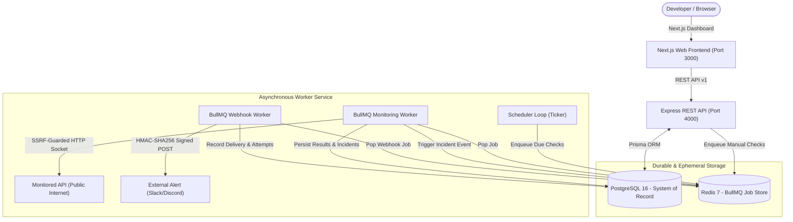

# TraceDeck ⚡

<p align="center">
  <strong>API Observability & Incident Management SaaS Platform</strong>
</p>

<p align="center">
  <em>Monitor. Detect. Investigate. Resolve.</em>
</p>

<p align="center">
  
  
  
  
  
  
  
  
  
  
  
  
</p>

---

## 📌 Overview

**TraceDeck** is a developer-first API observability and incident management platform designed for modern engineering teams. It continuously monitors endpoint availability, measures high-resolution latency metrics (Average, P50, P95, P99), automatically detects service degradation, manages full incident lifecycles, and dispatches HMAC-signed webhooks with exponential backoff.

Unlike traditional CRUD apps or toy uptime monitors, TraceDeck is built with an **enterprise-grade backend**: decoupled background workers, socket-level connect-time SSRF defenses, database-enforced incident deduplication, and strictly real-data metric aggregations.

---

## 🏗️ System Architecture



---

## 🚀 Key Engineering Differentiators

### 1. Connect-Time SSRF Defense (Zero-Trust Socket Validation)

- **The Vulnerability**: Validating a URL before fetching leaves an attacker open to **DNS Rebinding** and **Time-of-Check to Time-of-Use (TOCTOU)** attacks (e.g., domain returns a public IP during pre-check, but returns `169.254.169.254` cloud metadata at connect time).
- **Our Solution**: TraceDeck hooks directly into Undici's HTTP agent `connect.lookup`. Every resolved IP address is checked at the socket layer immediately before the TCP connection is established.
- **Blocks**: Cloud metadata (`169.254.169.254`), Loopback (`127.0.0.1`, `localhost`, `[::1]`), Private RFC1918 subnets (`10.0.0.0/8`, `172.16.0.0/12`, `192.168.0.0/16`), IPv4-mapped IPv6 (`::ffff:127.0.0.1`), Decimal IPs (`2130706433`), and non-HTTP schemes.
- **Zero Resource Leaks**: `maxRedirections: 0` (redirects are recorded as 3xx outcomes, never followed) and response streams are immediately destroyed (`res.body.destroy()`) to prevent OOM denial-of-service from large response payloads.

### 2. ACID Incident Deduplication via Partial Unique Index

- **The Problem**: When a service goes down, repeated checks will trigger repeated failure alerts. Naive application checks like `findFirst({ where: { status: 'OPEN' } })` fail under distributed concurrent workers due to race conditions.
- **Our Solution**: Enforced at the storage engine level with a PostgreSQL **Partial Unique Index**:
  ```sql
  CREATE UNIQUE INDEX "idx_incident_single_active_per_monitor"
  ON "Incident" ("monitorId")
  WHERE "status" != 'RESOLVED';
  ```
  Any concurrent attempt to open a duplicate active incident triggers a constraint violation (`23505`), which the service catches idempotently.

### 3. Decoupled Job Processing Pipeline

- Synchronous HTTP request handlers in the API **never** perform external health checks.
- All scheduled and manual checks are pushed to BullMQ queues with deterministic job IDs (`check:{monitorId}:{bucket}`) to guarantee deduplication and worker recovery upon node crashes.

### 4. Real Performance Analytics (P50 / P95 / P99)

- No mock or hardcoded statistics. Analytics are dynamically computed from raw persisted `MonitorResult` rows across customizable windows (1h, 24h, 7d, 30d).

### 5. Reliable Webhook Delivery

- Outbound notifications sign payloads using `X-TraceDeck-Signature: sha256=<HMAC>` and `X-TraceDeck-Timestamp` to protect recipients against spoofing and replay attacks.
- Transient network failures are rescheduled using exponential backoff with full delivery attempt logging.

---

## 📦 Monorepo Structure

```text
tracedeck/
├── apps/
│   ├── api/             # Express REST API (Auth, Monitors, Incidents, Analytics)
│   ├── web/             # Next.js 14 Developer Dashboard (Tailwind CSS, shadcn/ui)
│   └── worker/          # BullMQ Background Worker (Scheduler, Check Runner, Webhooks)
├── packages/
│   ├── database/        # Prisma schema, migrations & database singleton
│   ├── shared/          # Shared TypeScript interfaces & DTOs
│   └── validation/      # Shared Zod validation schemas
├── docs/                # Architecture, PRD, Security & Decision records
├── docker-compose.yml   # Multi-container orchestration (Postgres, Redis)
└── package.json         # Workspace root configuration
```

---

## 🛠️ Technology Stack

| Layer              | Technology                     | Purpose                                                             |
| :----------------- | :----------------------------- | :------------------------------------------------------------------ |
| **Frontend**       | Next.js 14 + TypeScript        | Responsive, modern developer dashboard                              |
| **Styling**        | Tailwind CSS + Lucide Icons    | Dark-mode developer SaaS aesthetic (Linear / Better Stack inspired) |
| **Backend API**    | Node.js + Express + TypeScript | Modular, versioned REST API (`/api/v1`)                             |
| **Database**       | PostgreSQL 16                  | Durable relational system of record                                 |
| **ORM**            | Prisma 5.22                    | Type-safe schema migrations and database queries                    |
| **Job Queue**      | BullMQ + Redis 7               | Asynchronous job execution, retries, and bounded concurrency        |
| **HTTP Egress**    | Undici + Custom DNS Hooks      | SSRF-safe outbound HTTP health checks                               |
| **Authentication** | JWT + Bcrypt                   | Secure password hashing (cost factor 12) & organization workspaces  |
| **Testing**        | Vitest + Supertest             | Unit, integration, and security test suites                         |
| **Infrastructure** | Docker Compose                 | Containerized local and deployment runtime                          |

---

## 🚦 Getting Started

### Prerequisites

- [Node.js](https://nodejs.org/) >= 20.x (v22 LTS recommended)
- [Docker](https://www.docker.com/) & Docker Compose
- Git

### 1. Clone the Repository

```bash
git clone https://github.com/Ved10ant/TraceDeck.git
cd TraceDeck
```

### 2. Environment Configuration

Copy `.env.example` to `.env`:

```bash
cp .env.example .env
```

### 3. Spin Up PostgreSQL & Redis

```bash
docker compose up -d postgres redis
```

### 4. Install Dependencies & Generate Prisma Client

```bash
npm install
npm run db:generate
```

### 5. Start Development Stack

```bash
# Start the API server
npm run dev:api

# Start the background worker
npm run dev:worker

# Start the Next.js web application
npm run dev:web
```

- **Web Dashboard & Landing**: `http://localhost:3000`
- **REST API**: `http://localhost:4000`
- **API Healthcheck**: `http://localhost:4000/health`

---

## 🎨 Design System & Frontend Architecture

TraceDeck features a dual-theme design system combining a warm off-white editorial landing page with a dense, dark-mode developer dashboard (inspired by Linear and Better Stack):

* **Typography**: Instrument Sans (Display headings with tight tracking), Instrument Serif (Editorial italic highlights), Inter (Body UI), JetBrains Mono (Code, telemetry & latencies), and Space Grotesk (Stat numerals).
* **Landing Palette**: Warm canvas (`#F6F5F1`), crisp surfaces (`#FFFFFF`), dark contrast band (`#121316`), and text ink (`#0E0E10`).
* **Conversion CTA**: Signature orange pill (`#FF5A1F`, hover `#E84A10`) with animated circular arrow icon — reserved strictly for primary conversions to prevent visual confusion with alerts or error states.
* **Dashboard Theme**: Default dark slate (`#0A0B0F` bg, `#12141A` surface, `#23262F` border) with an instant light theme toggle.
* **Data Honesty**: Zero fabricated vanity metrics, fake testimonials, or hardcoded mock monitors. Live dashboard features real empty states with guided onboarding, while landing page preview cards are visibly labeled with an amber `SAMPLE DATA` badge.

---

## 🧪 Testing & Quality Assurance

TraceDeck enforces automated testing for every milestone:

```bash
# Run all automated tests across workspaces
npm test

# Run API & Authentication test suite
npx vitest run --dir apps/api
```

### Automated Security Test Matrix (SSRF)

| Threat Category       | Test Input                                             | Defense Mechanism                      |
| :-------------------- | :----------------------------------------------------- | :------------------------------------- |
| **Cloud Metadata**    | `http://169.254.169.254`                               | Blocked (`linkLocal` range)            |
| **Loopback**          | `http://127.0.0.1`, `http://localhost`, `http://[::1]` | Blocked (pre-check & DNS lookup)       |
| **RFC1918 Private**   | `http://10.0.0.1`, `http://192.168.1.1`                | Blocked (`private` range)              |
| **Decimal / Hex IPs** | `http://2130706433`                                    | Normalized by WHATWG parser -> Blocked |
| **IPv4-Mapped IPv6**  | `http://[::ffff:127.0.0.1]`                            | Unwrapped to IPv4 -> Blocked           |
| **DNS Rebinding**     | Rebinding domain targeting private IP                  | Socket-level connect-time validation   |
| **Bad Protocols**     | `file:///etc/passwd`, `ftp://example.com`              | Blocked at URL scheme pre-check        |

---

## 📚 Engineering Documentation

Comprehensive architectural design records are maintained in [`/docs`](file:///c:/Users/prach/OneDrive/Desktop/MY/TraceDeck/docs):

- [Detailed PRD (`docs/PRD.md`)](file:///c:/Users/prach/OneDrive/Desktop/MY/TraceDeck/docs/PRD.md)
- [System Architecture & Data Flows (`docs/ARCHITECTURE.md`)](file:///c:/Users/prach/OneDrive/Desktop/MY/TraceDeck/docs/ARCHITECTURE.md)
- [Database Schema & ER Diagrams (`docs/DATABASE.md`)](file:///c:/Users/prach/OneDrive/Desktop/MY/TraceDeck/docs/DATABASE.md)
- [API Endpoint Contracts (`docs/API.md`)](file:///c:/Users/prach/OneDrive/Desktop/MY/TraceDeck/docs/API.md)
- [Security Threat Model & SSRF Guide (`docs/SECURITY.md`)](file:///c:/Users/prach/OneDrive/Desktop/MY/TraceDeck/docs/SECURITY.md)
- [Technical Decisions Record (`docs/DECISIONS.md`)](file:///c:/Users/prach/OneDrive/Desktop/MY/TraceDeck/docs/DECISIONS.md) - _Plain-English explanations for interviews_
- [Implementation Milestone Status (`docs/IMPLEMENTATION_STATUS.md`)](file:///c:/Users/prach/OneDrive/Desktop/MY/TraceDeck/docs/IMPLEMENTATION_STATUS.md)

---

## 📄 License

This project is licensed under the [MIT License](LICENSE).
