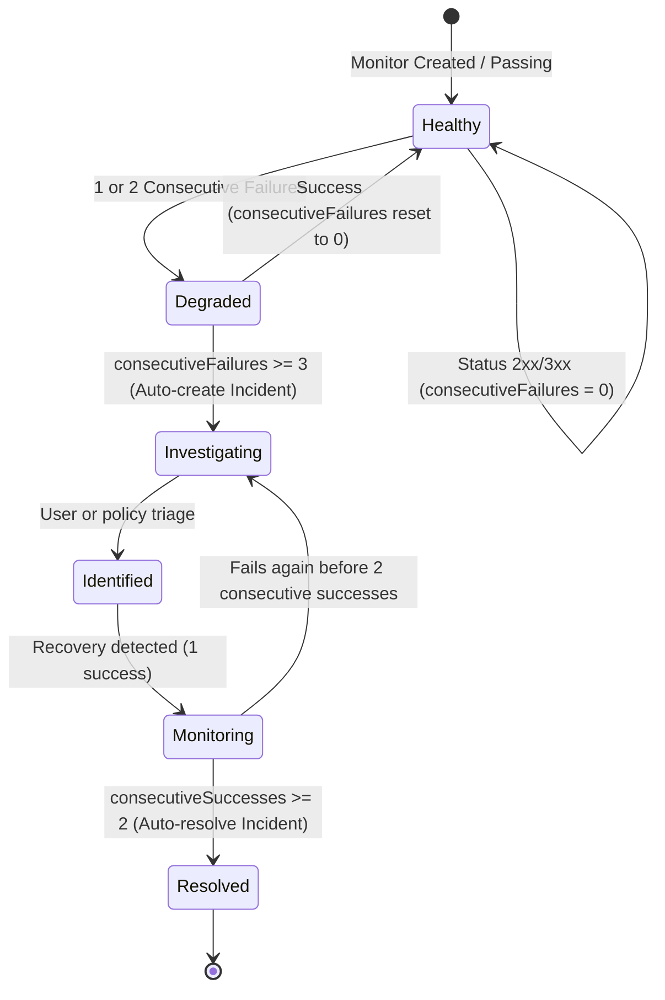
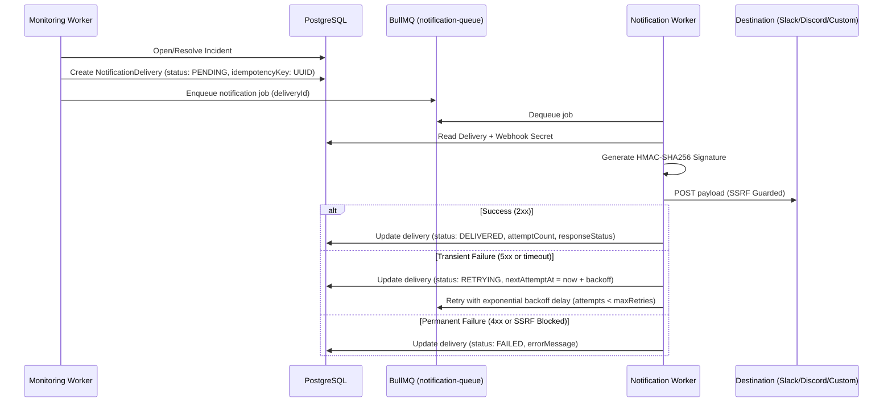

# System Architecture — TraceDeck-Lite

## 1. High-Level Architecture Diagram

```mermaid
flowchart TD
    User([Developer / Browser]) -->|HTTP / React| WebApp["Next.js Web Frontend (Port 3000)"]
    WebApp -->|REST API Calls (Bearer Token / Cookie)| API["Express REST API (Port 4000)"]
    
    subgraph Data & Storage
        Postgres[(PostgreSQL 16)]
        Redis[(Redis 7 - BullMQ Store)]
    end
    
    API <-->|Prisma ORM| Postgres
    API -->|Enqueue Manual Test Job| Redis
    
    subgraph Background Execution Pipeline ["Combined Worker Service (scheduler/worker)"]
        Scheduler["Scheduler Loop (Ticker)"]
        Scheduler -->|Enqueue Due Checks| Redis
        
        MonWorker["BullMQ Monitoring Worker"]
        MonWorker -->|Pop Check Job| Redis
        MonWorker -->|SSRF-Guarded HTTP Request| Target["Monitored Endpoint (Public Internet)"]
        MonWorker -->|Persist Result & Check State| Postgres
        MonWorker -->|If Threshold Met: Open/Resolve Incident| Postgres
        MonWorker -->|Enqueue Webhook Alert| Redis
        
        NotifWorker["BullMQ Notification Worker"]
        NotifWorker -->|Pop Webhook Job| Redis
        NotifWorker -->|SSRF-Guarded POST + HMAC| WebhookDest["External Webhook URL"]
        NotifWorker -->|Record Attempt & Next Retry| Postgres
    end
```

## 2. Process Topology (Revision 1.1 Consolidation)

To eliminate operational fragility and accommodate free-tier hosting limits without compromising architectural boundaries, TraceDeck-Lite uses 3 distinct execution containers:

1. **`web` (Next.js)**: Server-side rendered pages and client dashboard. Communicates exclusively with the API via `/api/v1/*`.
2. **`api` (Node.js + Express + TypeScript)**: Stateless REST API handling authentication, CRUD operations, analytics queries, and manual test dispatch.
3. **`worker` (Node.js + TypeScript)**: Dedicated long-running process containing:
   - **Scheduler loop**: Identifies monitors whose `nextCheckAt <= now()` and pushes check jobs to BullMQ.
   - **`monitor-queue` worker**: Consumes health check jobs with bounded concurrency (e.g. concurrency: 10), executes the guarded HTTP request, calculates latency, persists the `MonitorResult`, updates `Monitor.lastCheckedAt` & `Monitor.nextCheckAt`, evaluates incident transition logic, and dispatches webhook events.
   - **`notification-queue` worker**: Consumes webhook delivery jobs, signs payloads with HMAC-SHA256, performs outbound POST through the SSRF guard, and logs delivery attempts.
   - **Cleanup cron**: Runs periodically (e.g. daily) to prune `MonitorResult` entries older than 30 days.

## 3. Asynchronous Job & Scheduling Strategy

### 3.1 Duplicate Scheduling Prevention
- Each scheduled check job has a deterministic BullMQ `jobId`:
  `jobId = check:{monitorId}:{timestampBucket}`
  where `timestampBucket` is rounded to the monitor's interval. This guarantees idempotency at the queue level if the scheduler runs multiple iterations or restarts.
- The monitor record updates `nextCheckAt = now + interval` atomically during scheduling or upon job completion.

### 3.2 Bounded Concurrency & Worker Health
- Worker instances configure concurrency limits (e.g., max 10 concurrent HTTP checks per worker node).
- Job lock duration, stall intervals, and graceful `SIGTERM` / `SIGINT` handlers ensure jobs in-flight are not abandoned or double-processed.

## 4. Incident State Machine



### Concurrency-Safe Incident Creation
- To eliminate race conditions between parallel worker jobs, a PostgreSQL **partial unique index** is placed on `Incident(monitorId)` where `status != 'Resolved'`.
- If two jobs attempt to open an incident simultaneously, one succeeds and the other encounters a unique constraint violation (`23505` / Prisma `P2002`), which is caught and handled idempotently without throwing unhandled exceptions.

## 5. Webhook Delivery & Idempotency Pipeline


