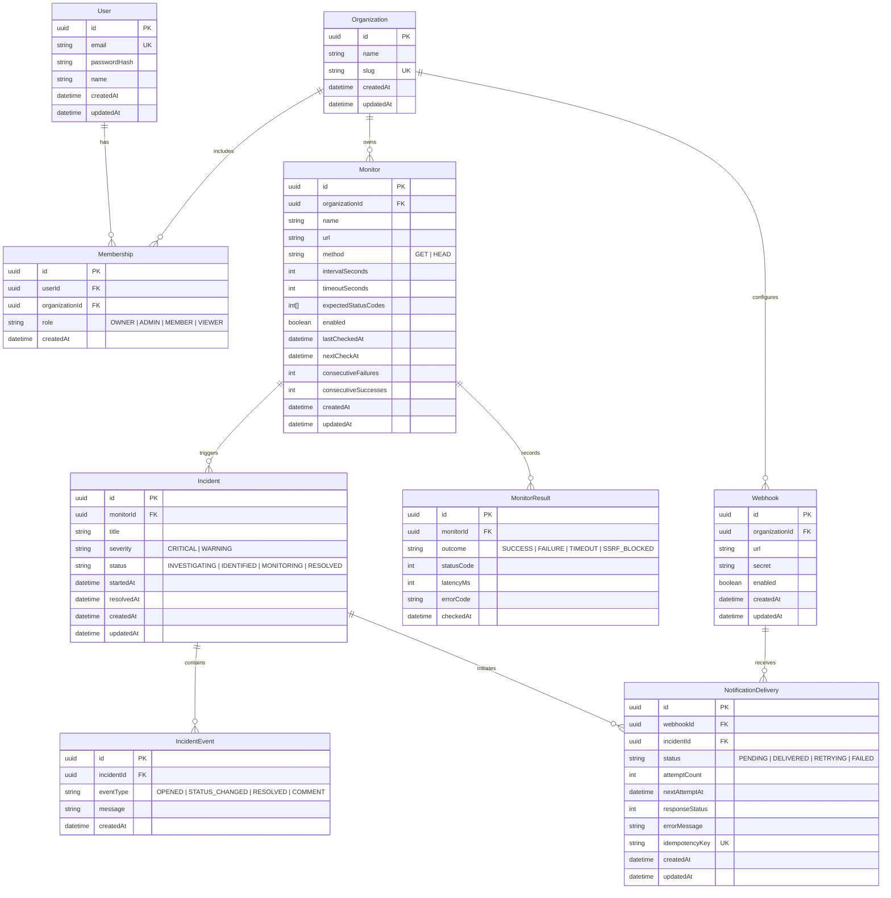

# Database Design & Schema — TraceDeck-Lite

## 1. Entity Relationship (ER) Diagram



## 2. Prisma Schema Proposal (`packages/database/prisma/schema.prisma`)

```prisma
datasource db {
  provider = "postgresql"
  url      = env("DATABASE_URL")
}

generator client {
  provider = "prisma-client-js"
}

model User {
  id           String       @id @default(uuid()) @db.Uuid
  email        String       @unique
  passwordHash String
  name         String
  createdAt    DateTime     @default(now())
  updatedAt    DateTime     @updatedAt
  memberships  Membership[]
}

model Organization {
  id          String       @id @default(uuid()) @db.Uuid
  name        String
  slug        String       @unique
  createdAt   DateTime     @default(now())
  updatedAt   DateTime     @updatedAt
  memberships Membership[]
  monitors    Monitor[]
  webhooks    Webhook[]
}

enum Role {
  OWNER
  ADMIN
  MEMBER
  VIEWER
}

model Membership {
  id             String       @id @default(uuid()) @db.Uuid
  userId         String       @db.Uuid
  organizationId String       @db.Uuid
  role           Role         @default(OWNER)
  createdAt      DateTime     @default(now())

  user         User         @relation(fields: [userId], references: [id], onDelete: Cascade)
  organization Organization @relation(fields: [organizationId], references: [id], onDelete: Cascade)

  @@unique([userId, organizationId])
  @@index([userId])
  @@index([organizationId])
}

enum HttpMethod {
  GET
  HEAD
}

model Monitor {
  id                    String          @id @default(uuid()) @db.Uuid
  organizationId        String          @db.Uuid
  name                  String
  url                   String
  method                HttpMethod      @default(GET)
  intervalSeconds       Int             @default(300)
  timeoutSeconds        Int             @default(10)
  expectedStatusCodes   Int[]           @default([200])
  enabled               Boolean         @default(true)
  lastCheckedAt         DateTime?
  nextCheckAt           DateTime        @default(now())
  consecutiveFailures   Int             @default(0)
  consecutiveSuccesses  Int             @default(0)
  createdAt             DateTime        @default(now())
  updatedAt             DateTime        @updatedAt

  organization Organization    @relation(fields: [organizationId], references: [id], onDelete: Cascade)
  results      MonitorResult[]
  incidents    Incident[]

  @@index([organizationId])
  @@index([enabled, nextCheckAt])
}

enum CheckOutcome {
  SUCCESS
  FAILURE
  TIMEOUT
  SSRF_BLOCKED
}

model MonitorResult {
  id          String       @id @default(uuid()) @db.Uuid
  monitorId   String       @db.Uuid
  outcome     CheckOutcome
  statusCode  Int?
  latencyMs   Int?
  errorCode   String?
  checkedAt   DateTime     @default(now())

  monitor Monitor @relation(fields: [monitorId], references: [id], onDelete: Cascade)

  @@index([monitorId, checkedAt(sort: Desc)])
  @@index([checkedAt])
}

enum IncidentSeverity {
  CRITICAL
  WARNING
}

enum IncidentStatus {
  INVESTIGATING
  IDENTIFIED
  MONITORING
  RESOLVED
}

model Incident {
  id          String           @id @default(uuid()) @db.Uuid
  monitorId   String           @db.Uuid
  title       String
  severity    IncidentSeverity @default(CRITICAL)
  status      IncidentStatus   @default(INVESTIGATING)
  startedAt   DateTime         @default(now())
  resolvedAt  DateTime?
  createdAt   DateTime         @default(now())
  updatedAt   DateTime         @updatedAt

  monitor      Monitor                @relation(fields: [monitorId], references: [id], onDelete: Cascade)
  events       IncidentEvent[]
  deliveries   NotificationDelivery[]

  @@index([monitorId])
  @@index([status])
}

enum IncidentEventType {
  OPENED
  STATUS_CHANGED
  RESOLVED
  COMMENT
}

model IncidentEvent {
  id         String            @id @default(uuid()) @db.Uuid
  incidentId String            @db.Uuid
  eventType  IncidentEventType
  message    String
  createdAt  DateTime          @default(now())

  incident Incident @relation(fields: [incidentId], references: [id], onDelete: Cascade)

  @@index([incidentId, createdAt])
}

model Webhook {
  id             String                 @id @default(uuid()) @db.Uuid
  organizationId String                 @db.Uuid
  url            String
  secret         String
  enabled        Boolean                @default(true)
  createdAt      DateTime               @default(now())
  updatedAt      DateTime               @updatedAt

  organization Organization           @relation(fields: [organizationId], references: [id], onDelete: Cascade)
  deliveries   NotificationDelivery[]

  @@index([organizationId])
}

enum DeliveryStatus {
  PENDING
  DELIVERED
  RETRYING
  FAILED
}

model NotificationDelivery {
  id             String         @id @default(uuid()) @db.Uuid
  webhookId      String         @db.Uuid
  incidentId     String         @db.Uuid
  status         DeliveryStatus @default(PENDING)
  attemptCount   Int            @default(0)
  nextAttemptAt  DateTime?
  responseStatus Int?
  errorMessage   String?
  idempotencyKey String         @unique
  createdAt      DateTime       @default(now())
  updatedAt      DateTime       @updatedAt

  webhook  Webhook  @relation(fields: [webhookId], references: [id], onDelete: Cascade)
  incident Incident @relation(fields: [incidentId], references: [id], onDelete: Cascade)

  @@index([status, nextAttemptAt])
}
```

## 3. Database Partial Unique Index (Raw SQL Migration)

Prisma does not support partial unique indexes directly in `schema.prisma`. To enforce **at most one active incident per monitor** at the storage engine level, a raw SQL migration is executed:

```sql
-- Migration: Add partial unique index for active incidents
CREATE UNIQUE INDEX "idx_incident_single_active_per_monitor"
ON "Incident" ("monitorId")
WHERE "status" != 'RESOLVED';
```

### Concurrency Handling
When parallel workers process failing health checks simultaneously, the first transaction commits the incident row. The second transaction triggers Postgres error code `23505` (unique_violation). The service catches this specific error and queries the existing active incident rather than failing the job or creating a duplicate.

## 4. Retention Policy & Data Pruning
- **Policy**: Raw `MonitorResult` entries are retained for 30 days.
- **Cleanup Strategy**: A scheduled worker job executes a chunked delete query:
```sql
DELETE FROM "MonitorResult"
WHERE "id" IN (
    SELECT "id" FROM "MonitorResult"
    WHERE "checkedAt" < NOW() - INTERVAL '30 days'
    LIMIT 5000
);
```
Batching with a limit prevents long-running table locks during cleanup.
